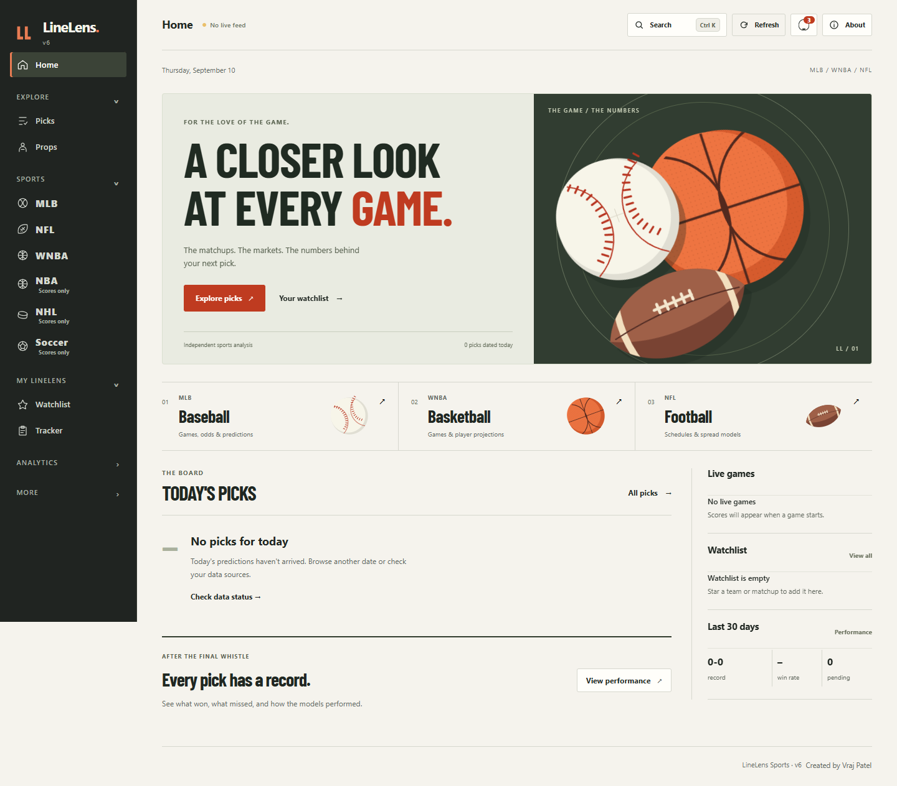
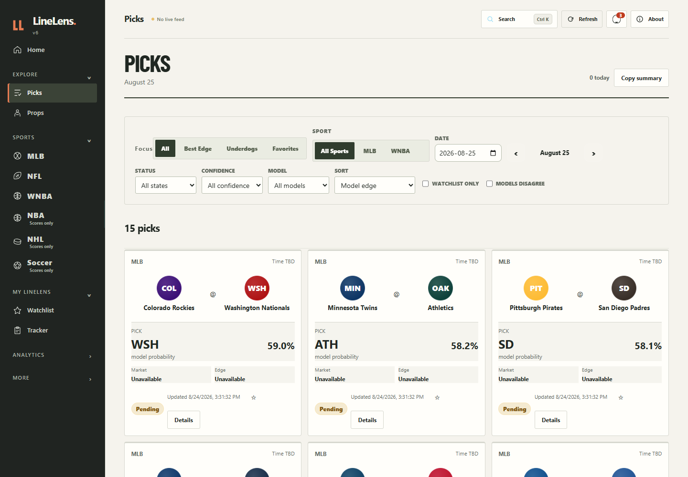
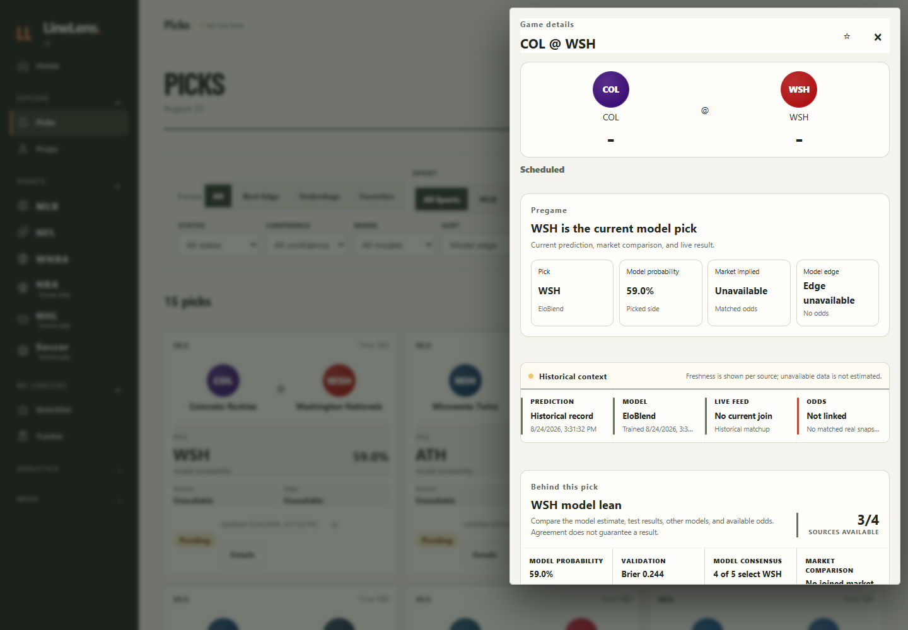
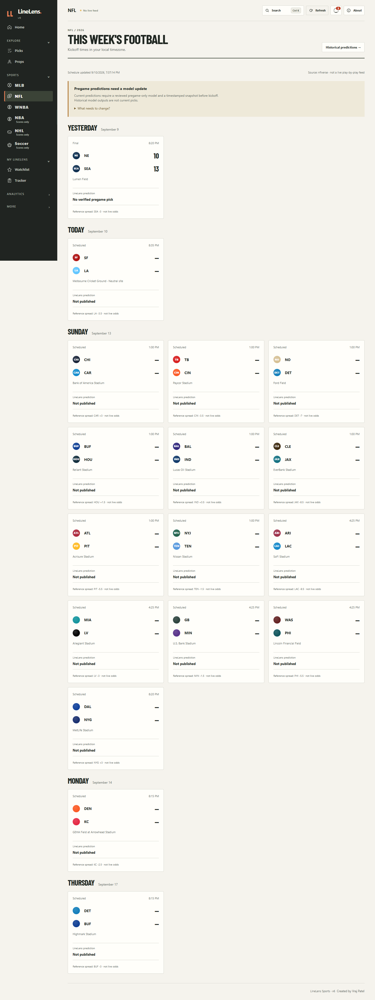
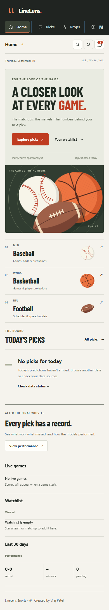

# LineLens Sports

LineLens is a desktop sports-intelligence app that compares machine-learning predictions with real market odds and tracks every prediction for long-term accountability.

## The new LineLens interface

A sports-editorial layout with paper-colored boards, charcoal navigation, original sports illustrations, and locally bundled typography. Scroll entrances and subtle ball movement respect your system's reduced-motion preference.

### Home

  

### Picks and matchup details

  
  

### Current NFL games and smaller screens

  
  

Screenshots show the actual bundled/offline client, not invented live scores. Dates, missing markets, and unpublished predictions reflect the available exports. Layout references included [ESPN's sport navigation](https://www.espn.com/) and [MLB's date-based scoreboard](https://www.mlb.com/scores); LineLens artwork and styling are original.

### UI checks

Run `npm run test:ui` for Chromium checks at 390, 768, and 1440 pixels, including navigation, overflow, date boundaries, reduced motion, and matchup details. Chrome or Edge is detected on Windows; elsewhere install a Playwright Chromium browser or set `LINELENS_BROWSER` to an executable path. Solid-color contrast reports and screenshots are written to `artifacts/editorial-tests/`.

To update this tour from real client captures in PowerShell, run `$env:CAPTURE_README='1'; npm run test:ui`.

### NFL availability

`npm run refresh:nfl:current` refreshes current fixtures from the public nflverse schedule without an API key. The NFL page opens on current games; historical predictions have a separate view. This schedule is not a live play-by-play feed.

The existing NFL artifact contains same-game player totals and is **not approved for pregame predictions**. Training now excludes those fields and reserves a separate calibration season, but a replacement artifact still needs training and holdout review. Current picks remain unpublished until that evidence and a prediction snapshot from before kickoff exist. Yesterday's results are never retroactively presented as successful pregame picks. Run `npm run test:nfl:current` to check these publication guards.

## Download LineLens

For Windows, open the repository’s [Releases](https://github.com/VrajP0518/LineLens/releases) page and choose the newest stable release.

Recommended for most users: the `LineLens_*_x64-setup.exe` installer. It installs the desktop app and creates the normal Windows shortcuts.

Use the `.msi` when LineLens is being installed through a managed or enterprise Windows deployment. The source tree and release notes may be newer than a published installer while a release is being prepared.

## What to look at first

1. Open **Home** for today’s strongest available opportunities, live games, and model health.
2. Open **Picks** for the full prediction feed. Each card separates LineLens probability, market-implied probability, model edge, and result status.
3. Open a matchup’s **GameCast** for odds, live state, box score, and the evidence behind the pick.
4. Use **Performance** to see scored results and **Prediction History** to inspect the source row behind any decision.

LineLens provides prediction pipelines for **MLB and WNBA**, plus **NFL historical analysis and current schedules**. NFL pregame predictions require a newly validated model, as described above. NBA, NHL, and Soccer are real-scoreboard views only; they do not claim a LineLens prediction model.

## Features

- Home dashboard focused on today’s best opportunities
- Picks: MLB and WNBA prediction feed
- Props: qualified and research-only player projections
- NFL / MLB / WNBA: sport-specific boards, date navigation, live scores, player-level box scores, and model context
- Picks focus filters: All, Best Edge, Underdogs, and Favorites
- GameCast: matchup detail, odds, timeline, and postgame review
- Models, Reports, and Performance: evaluation, health, and accountability
- My Tracker and Prediction History
- Personalized notifications
- Background refresh with cached-data fallback
- Settings release-readiness diagnostics and secret-safe support report
- MLB tabs: Games, Predictions, Players, and Economics, with payroll-versus-wins analysis

## Data policy and limitations

LineLens shows real available data. Missing, stale, schedule-only, pending, and unavailable states are labelled beside the affected board or market. A missing odds snapshot is not treated as a zero edge, and a missing live feed is not treated as a final score.

Predictions and market information are for educational analysis only and **NOT BETTING ADVICE**. Model probabilities are estimates, not guarantees; historical performance does not ensure future results.

## Tech Stack

- Python
- JavaScript
- HTML
- CSS
- ML: scikit-learn, NumPy, pandas, joblib
- Data processing: Polars, PyArrow, pybaseball, nfl-data-py
- Desktop app: Tauri 2 with Rust
- Rust libraries: serde and tauri-plugin-opener
- Packaging/CI: Node.js/npm, GitHub Actions, Windows .msi/.exe builds
- Storage: bundled JSON/JavaScript exports, local Parquet files, and browser localStorage

## Project links

- [Source code](https://github.com/VrajP0518/LineLens)
- [Report an issue](https://github.com/VrajP0518/LineLens/issues)
- [Releases](https://github.com/VrajP0518/LineLens/releases)

Created by [Vraj Patel](https://github.com/VrajP0518).
